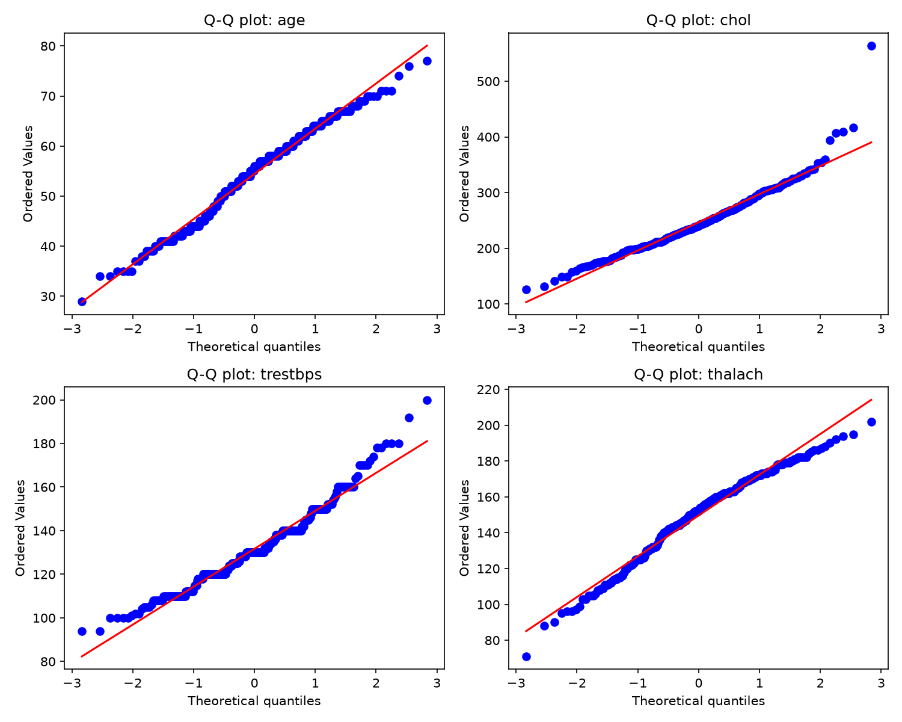
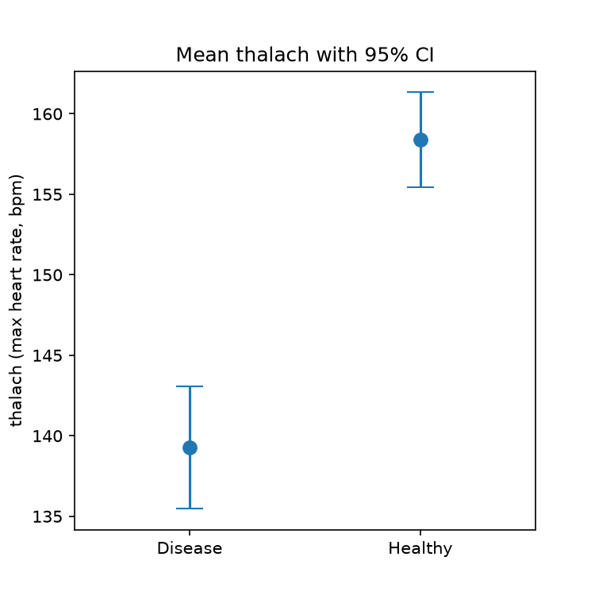
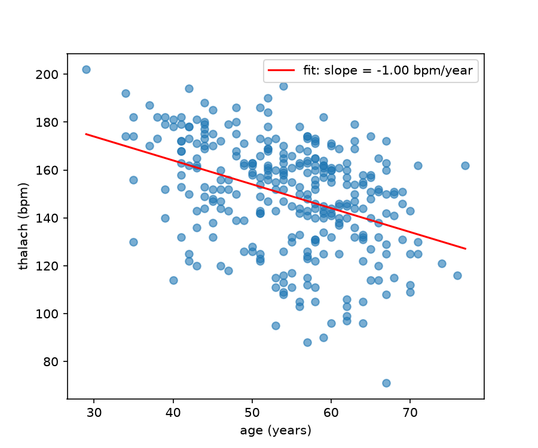

PW1 - Lab A: Reproducible Foundations

What I built:
- Set up a conda environment for the lab, then wrote tests for the given decay simulation and a script comparing the speed of its loop-based and NumPy-based versions.

Speed comparison (loop vs NumPy):
- Loop  (pure Python): 1.6288 s
- NumPy (vectorised):  0.0002 s
- NumPy is 7379.6x faster

Tests: yes, all passing 

Conclusion:
- I learned how to set up a reproducible environment and track my work with Git. The NumPy version was significantly faster than the pure Python loop. I ran into some Git issues initially but successfully reset and pushed everything to GitHub.

PW1 - Lab B

- The observed decay counts decrease over time, consistent with exponential decay.
- Comparing to the analytical law N0·e^(-λt) with λ = 0.3, the two curves [matched closely / diverged somewhat] - fill in based on what you actually saw in figure.png.
- The Snakemake pipeline runs plot_STUDENT.py to regenerate figure.png from decay_observed.csv, and only reruns when the input data or script changes.

PW3 - Data, Distributions, Testing, Causation

Data source: Heart Disease (Cleveland), UCI Machine Learning Repository / Kaggle.
303 patients, 14 columns. target: 164 healthy (0), 139 disease (1).

Session 1 - Shape of each variable

- age: ...
- chol: ...
- trestbps: ...
- thalach: ...

Session 1 - Normality

| Variable | Skew | Ex. kurtosis | Shapiro p | Q-Q plot | Verdict |
|---|---|---|---|---|---|
| age | -0.21 | -0.53 | 0.0061 | ... | ... |
| chol | 1.13 | 4.40 | <0.0001 | ... | ... |
| trestbps | 0.70 | 0.85 | <0.0001 | ... | ... |
| thalach | -0.53 | -0.07 | 0.0001 | ... | ... |
Session 2 - Is the effect real? (thalach, disease vs healthy)

Question: do heart-disease patients reach a different maximum heart rate than healthy ones?

Method: thalach was split by target (disease n = 139, healthy n = 164). I used Welch's t-test
because thalach is approximately normal (mild left skew, Q-Q plot close to the line), the groups
are large, and Welch does not assume equal variances. As a robustness check I also ran
Mann-Whitney U, which does not assume normality.

Results:
- Welch t-test: t = -7.86, p = 9.1e-14
- Mann-Whitney: U = 5806, p = 1.9e-13
- Cohen's d = -0.92 (large effect)

Conclusion: the null hypothesis (same mean) is rejected. Heart-disease patients reach a
significantly lower maximum heart rate (139.3 vs 158.4 bpm, about 19 bpm lower). Both tests
agree, so the conclusion does not depend on the method.

Uncertainty on the means (SEM = s / sqrt(n); 95% CI uses the t distribution):

| Group | n | Mean thalach (bpm) | SEM | 95% CI |
|---|---|---|---|---|
| Disease | 139 | 139.3 | 1.92 | [135.5, 143.0] |
| Healthy | 164 | 158.4 | 1.50 | [155.4, 161.3] |

The two 95% confidence intervals do not overlap (143.0 < 155.4), so the picture agrees with
the test result.

Session 2 - Age vs thalach

Pearson r = -0.394 (p = 1.1e-12), Spearman rho = -0.392 (p = 1.5e-12). Age and maximum heart
rate move in opposite directions: older patients tend to reach a lower maximum heart rate. The
relationship is moderate (r^2 = 0.15, so age explains about 15% of the variance in thalach).
Pearson and Spearman agree, so it is roughly linear and not driven by outliers. This is a
correlation only and does not prove that ageing causes the drop. The fitted slope is in the
legend of the plot: [copy the value, in bpm per year].

