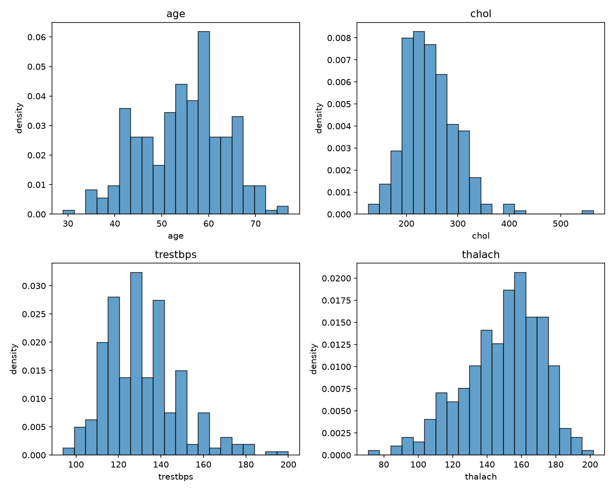

PW1 - Lab A: Reproducible Foundations

What I built:
- Set up a conda environment for the lab, then wrote tests for the given decay simulation and a script comparing the speed of its loop-based and NumPy-based versions.

Speed comparison (loop vs NumPy):
- Loop  (pure Python): 1.6288 s
- NumPy (vectorised):  0.0002 s
- NumPy is 7379.6x faster

Tests: yes, all passing 

Conclusion:
- I learned how to set up a reproducible environment and track my work with Git. The NumPy version was significantly faster than the pure Python loop. I ran into some Git issues initially but successfully reset and pushed everything to GitHub.

PW1 - Lab B

- The observed decay counts decrease over time, consistent with exponential decay.
- Comparing to the analytical law N0·e^(-λt) with λ = 0.3, the two curves [matched closely / diverged somewhat] - fill in based on what you actually saw in figure.png.
- The Snakemake pipeline runs plot_STUDENT.py to regenerate figure.png from decay_observed.csv, and only reruns when the input data or script changes.

PW3 - Data, Distributions, Testing, Causation

Data source: Heart Disease (Cleveland), UCI Machine Learning Repository / Kaggle.
303 patients, 14 columns. target: 164 healthy (0), 139 disease (1).

Session 1 - Shape of each variable

- age: ...
- chol: ...
- trestbps: ...
- thalach: ...

Session 1 - Normality

| Variable | Skew | Ex. kurtosis | Shapiro p | Q-Q plot | Verdict |
|---|---|---|---|---|---|
| age | -0.21 | -0.53 | 0.0061 | ... | ... |
| chol | 1.13 | 4.40 | <0.0001 | ... | ... |
| trestbps | 0.70 | 0.85 | <0.0001 | ... | ... |
| thalach | -0.53 | -0.07 | 0.0001 | ... | ... |